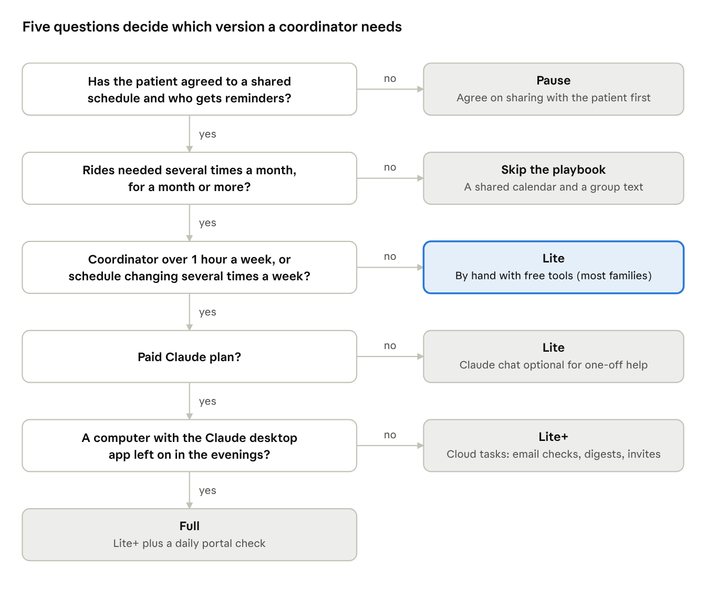
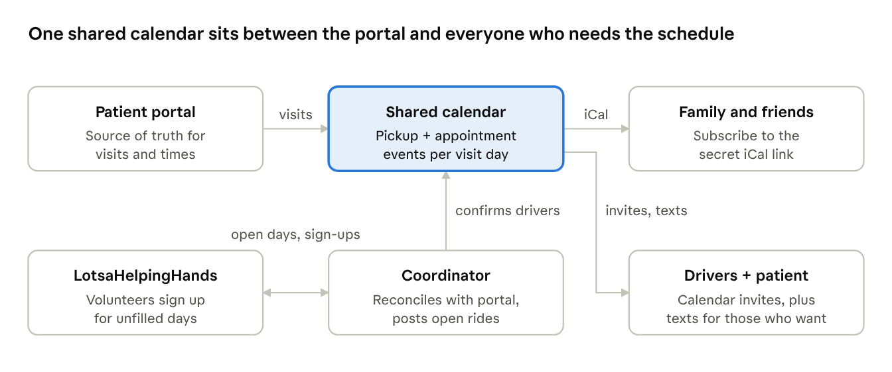

# Medical Ride Coordination Playbook

By Sarah · Licensed [CC BY 4.0](LICENSE)

## What this is

One coordinator keeps a single shared calendar of visits and rides, and volunteers sign up for drivers' slots. Followers get the schedule automatically and never log in; volunteers sign in to LotsaHelpingHands only to claim open rides.

It is built for a long course of treatment with frequent visits, such as daily radiation, infusions or dialysis. In that setting appointments change often, several volunteers rotate, and one person fields every "what time is it tomorrow?" question. The system was first run for a patient with several weeks of daily treatment at a major cancer center.

It works at three levels:

- **Lite:** run by hand with free tools, including calendar invites to drivers. Claude in chat is optional for one-off help.
- **Lite+:** a paid Claude plan runs scheduled tasks in the cloud: portal-email checks, digests, invites or texts. You still reconcile the portal weekly.
- **Full:** Lite+ plus a daily portal check, which needs a computer with the Claude desktop app left on in the evenings.

Start with Lite. Move up to Lite+ or Full only if the coordinator is overloaded.

## Start here: intake questions

Answer the questions below before setting anything up. Your answers tell you which version to run and which tools you need. The thresholds are rules of thumb, not hard limits.



Most families land on Lite. Move up only when the coordinator is overloaded, not because the tools exist.

**Which tools you need**

| Ask yourself | If yes | If no |
| --- | --- | --- |
| Does the hospital have an online patient portal (MyChart, Patient Gateway, etc.)? | Have the patient grant you proxy access. The portal becomes your source of truth. | Ask the clinic for a printed schedule at each visit, and update the calendar from calls. |
| Do more than two or three people need to see the schedule? | Use a dedicated Google Calendar, kept private and shared by its secret iCal link. | Use a shared calendar between you and the patient. |
| Will more than three people drive, or anyone outside close family? | Use LotsaHelpingHands for sign-ups on unfilled days. | Use a weekday roster and texts. |
| Do people keep asking "what time tomorrow?" | Send the Sunday schedule and night-before texts. | A weekly email or the calendar alone is enough. |
| Are there 10 or more people on the ride team? | Use calendar invites, or a dedicated texting number with opt-in (Lite+ or Full). | Use calendar invites (free), or text from your own phone. |
| Does the schedule change several times a week? | Lite+: scheduled portal-email checks twice a day, plus your weekly reconcile. Full adds a daily portal check. | Do the weekly Friday reconcile by hand. |
| Does the patient want family and friends to follow along? | Share the secret iCal link with them (times and places only). | Keep the calendar link private. |

**Run the intake with Claude**

Paste this into a new Claude chat, with this playbook attached or linked:

```markdown
I'm coordinating rides to medical appointments for someone in treatment. Use the attached Medical Ride Coordination Playbook to run its intake with me. Ask the intake questions one at a time, and wait for each answer. Then tell me:

1. Which version to run: Pause (talk with the patient first), Skip, Lite, Lite+, or Full.
2. The exact tools I need, and what to set up first.
3. A setup checklist tailored to my answers.

Don't ask for the patient's medical details. Times, places and the ride team are all you need.
```

## How the pieces fit

Lite runs on free tools; Lite+ and Full add a paid Claude plan and, optionally, a texting service. The coordinator keeps them in step.



The portal feeds the calendar, and the calendar feeds everyone else. The volunteer site only fills gaps, and the coordinator copies each sign-up back to the calendar by hand.

| Piece | Role | Who sees it |
| --- | --- | --- |
| Patient portal (MyChart, Patient Gateway, etc.) | Source of truth for visit dates, times and locations | Patient + proxy caregiver |
| Google Calendar (dedicated, private) | The schedule everyone follows; driver of record | Guests, plus people you give the secret iCal link |
| Calendar invites | Per-ride invite to the confirmed driver, with the patient and coordinator on it; reminders come from each person's own calendar app | Patient, coordinator, that day's driver |
| [LotsaHelpingHands](https://lotsahelpinghands.com) | Volunteer sign-ups for unfilled rides; updates and messages | Invited members |
| Texts and email (optional) | Reminders for people who prefer texts, plus digests for the coordinator | Each person, by their choice |

## Calendar design

Each visit day gets two events. The pickup event is the one drivers act on, and the appointment event is the one family and friends follow.

| Event | Title | Starts | Ends | Description holds |
| --- | --- | --- | --- | --- |
| Pickup | `<Driver> Pick <Name> Up` | 2 h before first appointment (or the portal's arrival time) | First appointment | Clinic address, Google/Apple/Waze links, a day key |
| Appointment | `<Name> – <Clinic>` | First appointment | Estimated finish | One line per appointment (time, building, floor), `Est. done ~<time>`, `Driver: <name>`, a day key |

**Estimating the finish:** set a default length for each visit type and add them up. For example: radiation 30 min, lab 30 min, clinic visit 60 min, nutrition 45 min, infusion 3 h. Drivers plan their day around the estimated finish, so err on the long side.

**Day key:** put a tag like `[sync-key: pt-2026-12-04]` at the bottom of each description. It lets you, or an automation, match calendar days against the portal without relying on titles people edit.

**Color = action needed:** a day with no confirmed driver is red on both events, titled `Driver Needed – Pick <Name> Up`, with `Driver: Needed` on the appointment. Clear the red only when a real person has confirmed.

**The patient and the main coordinator are guests on every event,** appointment and pickup alike. They are never removed, even when a driver changes. The confirmed driver is added to that day's pickup event (see Calendar invites for drivers).

**Keep the calendar private and share its secret link.** Don't make the calendar public. A patient's name next to a clinic tells anyone who finds it where they're being treated, and the feed may also include guests' email addresses. Instead, copy the calendar's **secret address in iCal format** from its settings (Integrate calendar) and give it only to people the patient approves. They can subscribe from Google, Apple or Outlook, and updates reach them automatically. If the link spreads too far, reset the secret address and re-share it.

**Use a first name or initials in titles,** for example `Driver Needed – Pick T Up`, never a full name.

## Drivers and ride requests

Only the coordinator assigns a driver, and the pickup title is the single source of truth for who is driving.

**Weekday roster.** Ask regular volunteers to take one weekday each, such as Monday Alex or Tuesday Jordan. That gives you a default suggestion for every new day, so most days fill with one quick text. A suggestion is not an assignment: the day stays red until the person says yes.

**Rules that prevent confusion:**

- A new day always starts as Driver Needed (red), even when the weekday default is likely.
- Confirm by changing the pickup title and the `Driver:` line together, then clearing the red.
- No automation or helper ever changes a driver, title or color on an existing day. Times can move; people can't.
- If the two events disagree, the pickup title wins.

**Unfilled days go to the volunteer site.** For any day still red about a week out, post a ride request on [LotsaHelpingHands](https://lotsahelpinghands.com) (free). Use type Giving Rides, 1 volunteer, one time slot from pickup to estimated finish plus 1 h, the clinic address, and visibility set to members only. When someone signs up, update the calendar by hand.

**Keep the volunteer site out of the calendar.** Don't put sign-up status lines or links in calendar events. Mixing the two systems led to stale and conflicting entries. The calendar holds times, places and the driver's name, and nothing else.

**Cancellations: mark, don't delete.** Use one sequence every time:

1. Confirm the cancellation with the clinic or the patient.
2. Retitle both events with `CANCELLED –` in front, change them to gray, and add a line saying who confirmed it and when. Leave the times and guests as they are, so there's a record.
3. Save with updates sent. The driver, patient and coordinator each get the change.
4. Cancel any LotsaHelpingHands ride task for that date.
5. If the ride was within 24 hours, also call the driver.

## Keeping it current

The patient portal (MyChart, Patient Gateway or similar) is the source of truth, and the calendar should be checked against it at least weekly. Reminder emails alone miss room and building changes.

**Get proxy access.** Most hospital portals let the patient grant a caregiver proxy access to their record. Do this first, because it's what makes everything else possible without asking the patient for screenshots.

**Weekly reconcile (Lite):** best done Friday afternoon.

1. Open the portal, switch to the patient's record, and list upcoming visits.
2. Compare each day to the calendar by date: first appointment time, list of appointments, building and floor.
3. New day: create both events as Driver Needed (red), with the patient and coordinator as guests.
4. Time changed: move the appointment, and move the pickup start to 2 h before the new first time. Keep the driver, and save with updates sent so the driver's invite updates automatically. Also call or text the driver if the pickup moved more than 30 minutes or the ride is within 24 hours.
5. Day gone from the portal: add a ⚠ note and confirm with the clinic or patient before marking it cancelled (see Cancellations). Visits sometimes drop off the list and come back.

**Between reconciles:** appointment-change emails from the portal give early warning. Treat them as a prompt to check the portal, not as the final word.

**Look further ahead than feels necessary.** Follow-up imaging and clinic visits are often booked months out. Reconcile the full list, not just the next two weeks.

## Communication cadence

Predictable messages at fixed times replace most one-off questions. Let each person choose which ones they get.

| Message | When | To | Content |
| --- | --- | --- | --- |
| Weekly schedule | Sunday afternoon | Whole ride team + patient | Each visit day Mon–Sun: date, pickup time, driver or "needed" |
| Coordinator digest | Sunday | Coordinator | This week, changes since last week, weeks 2–4 lookahead, unfilled days |
| Night-before reminder | ~7 PM the day before | Patient, driver, opted-in team | Driver, pickup time, first appointment, est. done |
| 30-minute heads-up | Pickup minus 30 min | Patient, driver | Driver, pickup time, live drive time, weather and road conditions if notable |
| Daily summary | Evening | Coordinator | Next 7 days at a glance, flags needing action |

**Text rules:**

- Send individual texts only. Group threads turn into reply-all noise.
- Use a dedicated ride number rather than the coordinator's personal phone, if possible. People opt in by texting START, and replies are forwarded to the coordinator.
- Give each person three choices per message type: every ride day, only days I drive, or none.
- When weather or traffic can't be confirmed for today, leave it out rather than guess.

**Lite version:** the Sunday schedule and the night-before reminder, sent by hand from the calendar, cover most of the need. Calendar invites (below) can replace the night-before text at no cost.

## Calendar invites for drivers

Calendar invites are a free alternative to texting. Each confirmed driver gets a standard invite for their pickup, with the patient and the main coordinator on it. Their own calendar app handles the reminders.

Invites work with Gmail, Outlook and iCloud, so drivers don't need a Google account and there's no texting service to pay for.

**Who is on each event**

| Event | Guests |
| --- | --- |
| Appointment | Patient + coordinator |
| Pickup, no driver yet (red) | Patient + coordinator |
| Pickup, driver confirmed | Patient + coordinator + driver |

**Guest settings on every event:** guests can't modify the event or invite others, and can see the guest list. That way the driver knows who the patient and coordinator are and can reply to them.

**One-time setup per driver**

- Add their email to the coordinator's private contacts list. It goes there, never in the calendar.
- Send them a note: "You'll get calendar invites for rides you've agreed to drive. [Patient] and [coordinator] are on each one too. Please accept, and set your calendar's default notifications (for example, 1 day and 1 hour before). Your calendar app sends the reminders, not us."

**Day to day**

| Situation | What to do | Who gets an email |
| --- | --- | --- |
| Driver confirmed | Add them to the pickup event, retitle it `<Driver> Pick <Patient> Up`, clear the red, then save and send. | Driver (invite), patient and coordinator (update) |
| Asking a driver (optional) | Add them to the red pickup event and leave it titled Driver Needed. Put this first in the description: "Accepting means you're available; I'll confirm." Their RSVP tells you who's available. Once you've chosen, retitle the event, which sends the confirmation, and remove anyone else you asked. | That driver, patient, coordinator |
| Time change | Move both events, then save and send. | Everyone on each event |
| Driver swap | Remove the old driver, add the new one, retitle, then save and send. Keep the patient and coordinator on. | Old driver (cancellation), new driver (invite), patient and coordinator |
| Visit cancelled | Follow the cancellation steps in Drivers and ride requests: retitle both events CANCELLED, gray them, save and send, and cancel any LotsaHelpingHands task. | Everyone |

**Trade-offs to expect**

- **Email volume:** the patient and coordinator get an email for every change. If that's too much, the patient can turn off invitation emails in their own calendar settings and still see every event.
- **Bulk loading:** loading weeks of visits at once sends one invite per event. Decide up front whether to send them or load silently and invite drivers only as they're confirmed.
- **Reminders:** reminder timing comes from each person's calendar settings. You can't set it for them.
- **Spam:** the first invite can land in spam. Ask everyone to accept one and mark the sender as safe.
- **Nuance:** invites carry less than a text, with no live traffic or weather. Crews that want that can combine invites with the 30-minute text.

## Setup

Each version builds on the one before, so start with Lite and add to it.

| | Lite (by hand) | Lite+ (Claude, cloud) | Full (Claude + computer) |
| --- | --- | --- | --- |
| Tools | Google Calendar (private), LotsaHelpingHands, patient portal proxy, calendar invites | Lite tools, plus a paid Claude plan with Google Calendar and Gmail connected. A texting service is optional. | Lite+ tools, plus the Claude desktop app on a computer left on in the evenings |
| Calendar updates | Weekly reconcile by hand | Twice-daily portal-email checks, plus a weekly portal reconcile with Claude | Daily portal check plus twice-daily email checks |
| Messages | Driver calendar invites, plus a Sunday schedule sent by hand | Scheduled digests, plus invites and/or texts by each person's choice | Same as Lite+ |
| Coordinator's role | Every update and message | Reviewing flags, confirming drivers, weekly reconcile | Reviewing flags and confirming drivers |

**Lite checklist**

- [ ] Get caregiver proxy access to the patient's portal.
- [ ] Create a dedicated Google Calendar named for the patient's treatment. Keep it private, and copy its secret address in iCal format (settings → Integrate calendar).
- [ ] Create a LotsaHelpingHands community and invite the ride team.
- [ ] Collect each volunteer's name, phone, email and preferred weekday, and ask how they want reminders: calendar invite, text or both. Get the patient's and coordinator's emails too.
- [ ] Load all upcoming visit days from the portal as two events each (see Calendar design). Mark every day red.
- [ ] Text weekday volunteers to confirm their days, then set titles and clear the red.
- [ ] Share the secret iCal link with the family and friends the patient approves.
- [ ] Put a Friday reconcile and a Sunday schedule text on your own calendar.

**Lite+ and Full (with Claude)**

- [ ] Do the Lite checklist first. The automation relies on the same calendar design.
- [ ] Create a Claude Project for the patient. Add this playbook, plus a private contacts doc with names, phones, emails and reminder preferences.
- [ ] Connect Google Calendar and Gmail. Add a texting service only if some people want texts.
- [ ] Ask Claude to set up scheduled tasks for the portal-email checks, the digests and any texts. Installing the [medical-ride-coordination skill](skills/medical-ride-coordination/SKILL.md) gives Claude these rules.
- [ ] **Lite+:** do a weekly portal reconcile with Claude in chat. Paste in, or show it, the upcoming visit list.
- [ ] **Full only:** add the daily portal-check task. Start the names of tasks that need the computer with "MAC" or "PC", so they're easy to find. Sign in to the portal yourself in the Claude desktop app's browser; Claude never types passwords or codes.
- [ ] Run one week in parallel with Lite before trusting it.

## Privacy and consent

The calendar, every invite and every text carry only times and places. Medical detail stays in the portal.

- **Get the patient's agreement** to the shared calendar, to who gets the secret link, and to who receives invites and texts. It's their information.
- **Leave out** visit types ("chemo", "scan results"), clinician names, diagnoses and test details, in event titles, descriptions and texts alike. "Main building, floor 7, 11:15" is enough for a driver.
- **Share only the secret link, never a public one.** Anyone holding it can see event details and possibly guests' email addresses, so give it only to people you'd trust with both. If in doubt, open the feed once and check what it shows.
- **Keep the volunteer site members-only.**
- **Keep the contact list private.** It belongs in the coordinator's own files, not in shared docs or calendar events.
- **Portal sign-in stays with a person.** No helper, human or AI, should store or type the portal password or one-time codes.
- **Before sharing any copy of your setup,** remove names, phone numbers, emails, calendar IDs and visit history.

## Lessons learned

Most problems came from two sources of truth disagreeing, so give each fact exactly one home.

- **Check the portal, not just the emails.** Emails didn't report room changes, and some changes never sent an email.
- **Don't delete a day on one signal.** A visit vanished from the portal and later turned out to be moved by a day. Flag it, confirm, then mark it cancelled. Don't delete it.
- **New days default to Driver Needed.** Pre-filling the usual weekday driver led people to assume they were booked.
- **Keep the volunteer site separate from the calendar.** Status lines copied into calendar events went stale within days.
- **Name automations clearly.** Put words like "needs the computer" or "OFF" at the start of the name, where they can't be cut off in a list.
- **Don't hand-make backup reminders with the same name** as an automated one. An automation can mistake the backup for its own task and skip a day.
- **Leave a gap rather than a guess.** Leave out weather or traffic that can't be confirmed for today. A stale forecast is worse than none.
- **Weekend visits have no default driver.** Post them to the volunteer site first.
